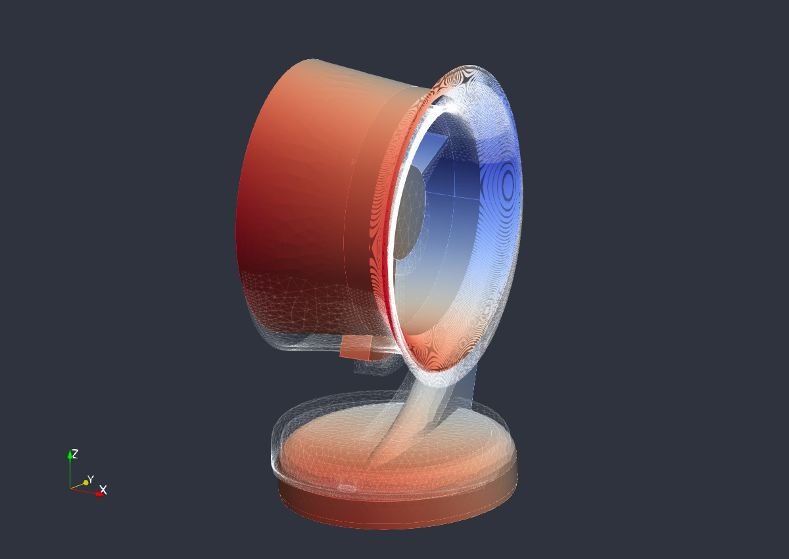
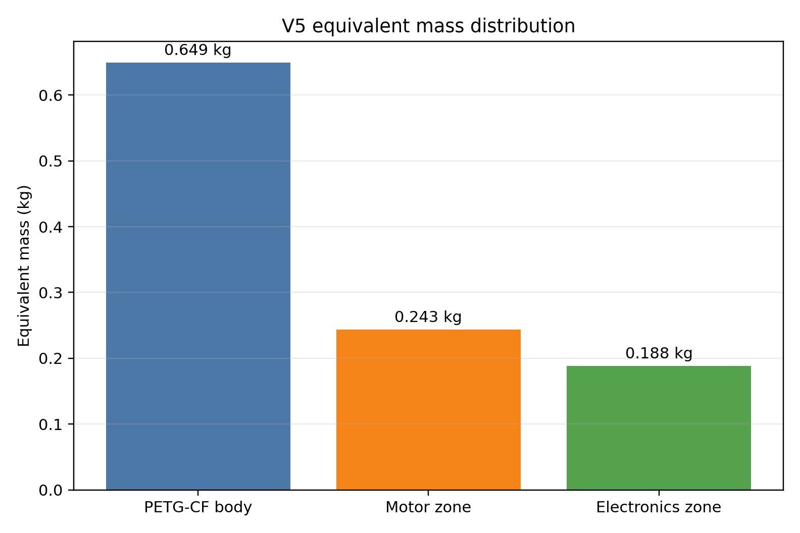

# Modal Analysis of a PETG-CF Fan Housing

Finite-element modal analysis of a PETG-CF fan housing, prepared as an engineering portfolio project. The study combines CAD cleanup, tetrahedral meshing, equivalent embedded masses for motor and electronics, Code_Aster eigenfrequency solving, ParaViS visualization, and a scientific report written in English.



## Executive Summary

The objective is to identify the elastic natural frequencies of a fan housing and compare them with the main excitation frequencies expected around 2000 rpm. The final V5 model is oriented in a physically readable configuration: the real base rests on the `XY` plane and the fan height follows `+Z`.

Key outcomes:

| Quantity | Result |
|---|---:|
| Material model | Equivalent isotropic PETG-CF |
| Mesh | 95,358 nodes / 312,777 TETRA4 elements |
| Total equivalent mass | 1.080446 kg |
| First elastic mode | 49.214 Hz |
| Rotation frequency at 2000 rpm | 33.333 Hz |
| Five-blade passing frequency | 166.667 Hz |
| Code_Aster diagnostic | OK |

The first elastic mode is above the 1X rotational excitation line. No computed mode is directly coincident with the five-blade passing frequency. The third elastic mode, at 131.946 Hz, is close to the 4X rotational harmonic at 133.333 Hz and is the main proximity point to monitor in later design iterations.

## Scientific Report

The complete report is available here:

- [PDF report](reports/modal_report_petgcf_v5_en.pdf)
- [LaTeX source](paper/main.tex)

The report documents the modeling assumptions, CAD simplification, mesh properties, material model, embedded mass representation, solver setup, modal results, excitation comparison, first-order blade mass sensitivity, and recommended next simulations.

## Methodology

The workflow was structured as follows:

1. CAD preparation: simplify small faces and short edges that were harmful to robust tetrahedral meshing.
2. Mesh generation: generate a NETGEN tetrahedral mesh suitable for repeated finite-element runs.
3. Mass modeling: represent the motor and electronics as equivalent localized mass regions.
4. Modal solving: run a free-free modal analysis in Code_Aster over the 1-1500 Hz frequency band.
5. Post-processing: visualize the first elastic mode and compare modal frequencies with rotational excitation lines.
6. Engineering interpretation: identify resonance proximity, modeling limits, and recommended next simulations.


## Main Results

| Elastic mode | Frequency (Hz) | Engineering note |
|---:|---:|---|
| 1 | 49.214 | Above 1X rotation at 2000 rpm |
| 2 | 73.181 | Below 3X harmonic |
| 3 | 131.946 | Close to 4X rotational harmonic |
| 4 | 250.576 | Higher flexible response |
| 5 | 289.925 | Higher flexible response |

The first-mode visualization uses amplified deformation for readability. It is a mode-shape representation, not a physical displacement amplitude.



## Repository Structure

```text
.
|-- README.md
|-- reports/
|   `-- modal_report_petgcf_v5_en.pdf
|-- paper/
|   |-- main.tex
|   |-- references.bib
|   |-- figures/
|   `-- tables/
|-- src/
|   |-- code_aster/
|   `-- postprocessing/
|-- cad/
|   |-- fan_housing_meshprep_v5_xy_z.step
|   `-- fan_housing_meshprep_v5_xy_z.brep
|-- data/
|   |-- modal_frequencies.csv
|   `-- equivalent_mass_distribution.csv
|-- docs/
|   |-- model_assumptions.md
|   `-- reproducibility.md
|-- assets/
|   |-- figures/
|   `-- animations/
`-- web/
    `-- index.html
```

## Reproducibility

The main Code_Aster command file is:

```text
src/code_aster/carter_modal_petgcf_composants_v5_socle_xy_z.comm
```

The oriented CAD geometry is provided in `cad/`. The original large solver result files are intentionally not all versioned in this portfolio repository to keep the repository lightweight and readable; the report and solver log provide the numerical traceability for the published results.

## Limitations

This is a design-level numerical modal analysis, not an experimental validation. The main limitations are:

- PETG-CF is approximated as an equivalent isotropic material.
- The modal model is free-free and does not include mounting or gasket stiffness.
- The blades are not explicitly meshed in the finite-element model.
- Damping is not estimated.
- The motor and electronics are represented through distributed equivalent masses.
- Drop/shock behavior requires transient dynamics and contact assumptions, not only modal analysis.

## Recommended Next Work

The most valuable next simulations are:

- supported modal analysis with circular gasket stiffness under the base;
- sensitivity study versus gasket stiffness and thickness;
- explicit blade mass and inertia representation;
- simplified shock analysis using an acceleration pulse for a table-drop case;
- experimental tap-test or accelerometer measurement to correlate the numerical frequencies.

## Author

Clement Dumeril  
Numerical simulation, CAD preparation, finite-element modeling, modal interpretation, and scientific reporting.
