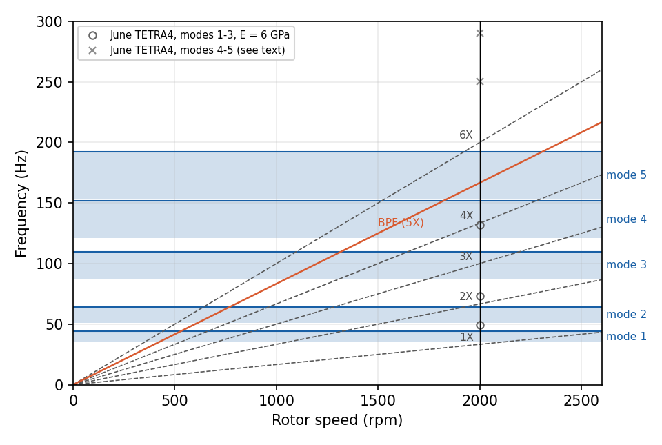
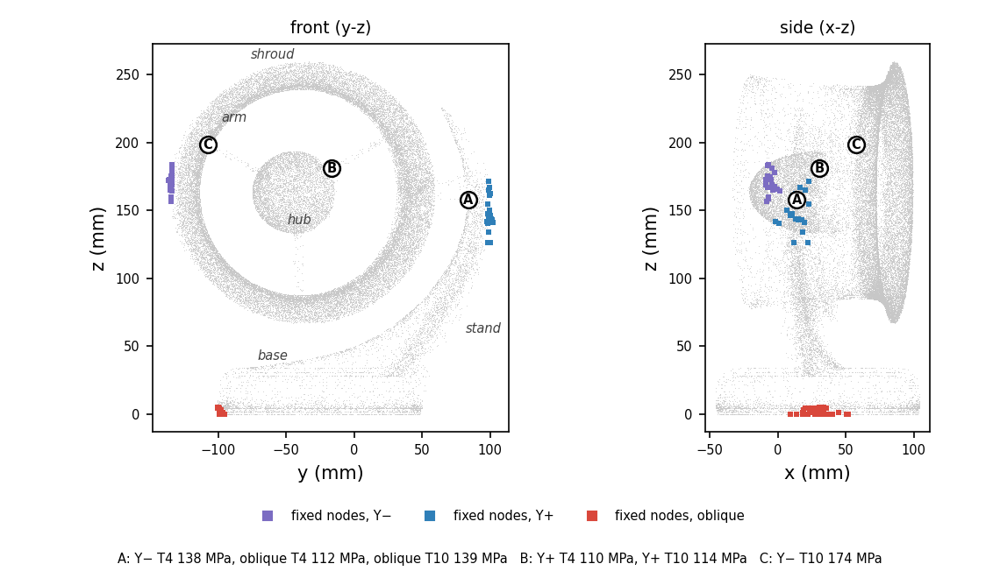
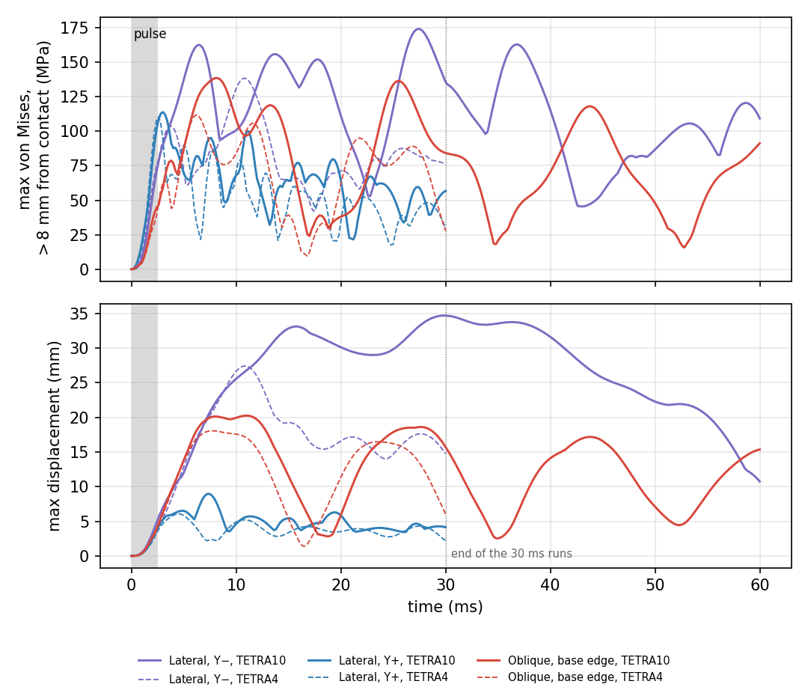
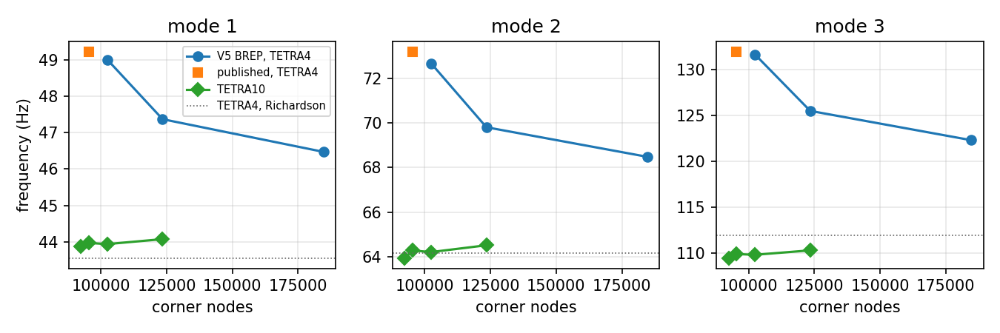

# Natural frequencies and impact response of a 3D-printed PETG-CF fan housing

Code_Aster study of a desk-fan housing printed in carbon-fibre PETG: free-free modes with an element-order convergence check, compared with the rotor harmonics at 2000 rpm, and three damped impact cases followed to 30 ms.

<p align="center">
  <br>
  <em>First elastic mode (shape from the June linear-element run; deformation amplified). With quadratic elements it is at 44 Hz for E = 6 GPa.</em>
</p>

The fan is one of the first projects of Polytechnia, the engineering consultancy I co-founded in 2026. The housing carries a brushless motor in the duct and the electronics in the base. In June 2026 I asked two questions before printing it: does a natural frequency sit on a rotor line, and where does the housing concentrate stress if the fan is knocked over. In October 2026 I reran the study and found that the June frequencies were 12 to 20 % too high (linear elements), the impact runs stopped too early, one impact case fixed a slice of the housing instead of a contact patch, and the modulus had no source. Internal Polytechnia study, not a client deliverable. The airflow and noise of the same fan are in [ducted-fan-aeroacoustics](https://github.com/clementdumeril/ducted-fan-aeroacoustics).

Skills: FE eigen-analysis against rotor harmonics, mesh and element-order convergence, linear transient FE with damping, singularity-aware post-processing, Python/h5py, Code_Aster and SALOME scripted end to end.

Full report, in preprint form: [`paper/main.pdf`](paper/main.pdf).

## Results

### Modes against the rotor lines

| Quantity | Value |
|---|---|
| Elastic modes 1 to 5, quadratic elements, E = 6 GPa ([`data/convergence/`](data/convergence)) | 44.0, 64.3, 109.9, 151.8, 192.1 Hz |
| Mode 1 over E = 3.8 to 6.0 GPa (f ∝ √E) | 35.0 to 44.0 Hz; it would reach 1X at E = 3.45 GPa |
| Rotor lines at 2000 rpm (nominal speed of this study) | 1X 33.3, 2X 66.7, 3X 100, 4X 133.3 Hz, BPF 166.7 Hz |
| Crossings inside the modulus range ([`fig_campbell.py`](paper/scripts/fig_campbell.py)) | mode 3 / 3X at 4.97 GPa, mode 4 / 4X at 4.63 GPa, mode 5 / BPF at 4.52 GPa |

<p align="center">
  <br>
  <em>Each band spans a mode for E = 3.8 GPa (bottom) to 6.0 GPa (top). Circles and crosses: the June linear-element values.</em>
</p>

The 6 GPa of the June model has no source; 3.8 GPa is the value published for printed PETG with 30 % carbon fibre (Prabhakaran et al., 2025). Within that range three modes cross a rotor line, so a resonance at 2000 rpm cannot be ruled out without measuring the printed part. The crossings of modes 4 and 5 appear only with quadratic elements: linear elements find no mode between 132 and 228 Hz.

### Impact (0 to 30 ms)

| Impact case | Peak von Mises > 8 mm from contact | Time | Location |
|---|---:|---:|---|
| Lateral, Y- (shroud touches the floor) | 174 MPa | 27.4 ms | C: upper arm to shroud |
| Lateral, Y+ (stand touches the floor) | 114 MPa | 3.0 ms | B: upper arm to motor hub |
| Oblique 45°, base edge touches the floor | 139 MPa | 8.2 ms | A: stand to shroud |

Quadratic elements, Rayleigh damping with a nominal 5 % at 15 and 300 Hz, which is 2.1 to 2.9 % between 29 and 152 Hz and 4.6 % at the 16.6 Hz rocking mode of the Y- case. Source: [`shock/results_extended/`](shock/results_extended); all element types and damping levels are in the report. Without damping the maximum keeps growing with the window (171, 172, 179, then 220 MPa at 27.4 ms for Y-), so only damped values are used; the two cases that had not settled were continued to 60 ms and stay below their 0 to 30 ms peaks.

The peaks are local (95th percentile below 23 MPa) and mesh- and geometry-sensitive: they sit at junctions where the detailed arms were simplified to plain ribs, and going from linear to quadratic elements raises them by 3 to 26 %. The late Y- peak comes with the rocking of the whole housing about a patch that stays clamped, probably an artefact of that boundary condition. The computed peaks exceed the strength reported for printed PETG-CF (about 60 MPa in the plane of the layers; 19 MPa across layers for unfilled PETG). A linear model with such peaks does not predict cracking; it says these junctions have no margin for a fall of this severity, which points to a soft bumper on the shroud and the base edge and larger fillets at the junctions.

<p align="center">
  <br>
  <em>Fixed nodes per case and the three peak locations, with the runs that peak there.</em>
</p>

<p align="center">
  <br>
  <em>Stress and displacement histories at a nominal 5 % damping: quadratic (solid) and linear (dashed) elements.</em>
</p>

## What I built

- CAD preparation ([`cad/`](cad)): the FreeCAD housing would not mesh because of small faces and intersecting surfaces. I defeatured it (small faces and short edges removed, the detailed arms replaced by plain ribs, one body taken out of a fusion; 1.4 % of the volume) and oriented it with the base on XY.
- Meshes ([`src/mesh/`](src/mesh)): SALOME `FULL_NETGEN`, 1 to 10 mm, fineness 2, 95,358 nodes; remeshes at fineness 1 to 4 for the convergence study, from the command line.
- Model: isotropic PETG-CF (E = 6 GPa, carried over 3.8 to 6.0 GPa; ν = 0.35; 1300 kg/m³); motor and electronics (estimated 0.090 and 0.075 kg) added as density in two spherical element groups, recomputed per mesh.
- Modal solves: `CALC_MODES`, free-free, TETRA4 and TETRA10.
- Impact ([`shock/extended_2026-10/`](shock/extended_2026-10)): the nodes where the housing touches the floor held fixed and a 251 g, 2.5 ms pulse on the rest. I replaced the June `DYNA_NON_LINE` (on a linear problem) by `DYNA_VIBRA`, about 15 times cheaper, with Rayleigh damping assembled from the material. The input generator takes its paths and options from the environment.
- Post-processing: h5py scripts that read the `.rmed` results and report the maximum and percentiles of the stress outside an 8 mm band around the contact ([`postprocess_extended.py`](shock/extended_2026-10/postprocess_extended.py)), and the report scripts ([`paper/scripts/`](paper/scripts)).

## How I checked it

<details>
<summary>Convergence, contact patches, window length, damping, solver and time step</summary>

- Element order and mesh: linear tetrahedra keep lowering the frequencies with refinement (mode 1 from 49.2 to 46.5 Hz between 95k and 185k nodes). Quadratic tetrahedra on four meshes (92k to 123k nodes) agree within 1 %; the meshes are close in size, so a Richardson extrapolation of the two finest linear meshes (43.6, 64.2, 111.9 Hz, within 1 to 2 %) gives an independent check.

  

- Contact patches ([`check_contact_planes.py`](shock/extended_2026-10/check_contact_planes.py), [output](shock/extended_2026-10/contact_planes_check.txt)): the June oblique plane was not tangent, so 1091 nodes in a slice through the shroud, stand and base were fixed, with 17,295 nodes beyond the plane. The October oblique case is tangent at the edge of the base; the lateral planes are tangent.
- Window length: Y- and oblique (quadratic, 5 %) continued to 60 ms; identical to the 30 ms runs up to 30 ms, later maxima lower (163 and 118 MPa).
- Damping: the Rayleigh ratio at each frequency is tabulated in the report.
- Solver and time step: `DYNA_VIBRA` matches the June `DYNA_NON_LINE` results to four digits up to 2.5 ms; halving the time step changes the Y- history by at most 0.4 % over 15 ms.
- June model checks: steel run scaled by √(E/ρ), mesh volume within 0.24 % of the CAD, mass-zone elements recounted from the MED file, Sturm count equal to the modes found.
- Runs: this Windows build of Code_Aster prints "DIAGNOSTIC JOB : OK" even after a fatal error, so every run was checked for the message text and its result files.

</details>

## Limitations

- No measured material property: isotropic, linear elastic; a printed part is anisotropic and weaker between layers.
- Simplified arms at the stress hot spots; free-free modes (stand support not modelled); motor and electronics as masses without stiffness; no blades.
- Impact: no contact law or rebound (the patch stays clamped), uniform pulse, assumed damping; the Y- case reaches 30 to 40 mm of displacement, at the edge of the small-displacement assumption.
- No tap test, accelerometer measurement or drop test yet.

## Reproduce

Requires Code_Aster 17.4 (16.9 for the June reference run), SALOME 9.13, Python 3 with numpy, matplotlib and h5py, and LaTeX.

```bash
# mesh the prepared CAD with SALOME-NETGEN (terminal mode)
CARTER_BREP_PATH=cad/fan_housing_meshprep_v5_xy_z.brep salome -t src/mesh/mesh_carter_netgen.py

# modal solve (edit the paths in the .export first)
run_aster src/code_aster/carter_modal_petgcf_composants_v5_socle_xy_z.export

# impact runs: CHOC_MESH = the MED mesh from the meshing step, CHOC_RUN_ASTER = your launcher
export CHOC_MESH=/path/to/carter_socle_xy_z_netgen.med CHOC_RUN_ASTER=run_aster
CHOC_QUAD=1 CHOC_ZETA=0.05 python shock/extended_2026-10/make_cases_vibra.py runs_q5 0.03 0.0002
run_aster runs_q5/cyl_ymin.export
python shock/extended_2026-10/postprocess_extended.py runs_q5 runs_q5/time_history.csv

# figures, tables and report
bash paper/build_paper.sh
```

On 2 threads of a 4-core i7-6700HQ: a TETRA4 modal run takes 3 to 5 min, a TETRA10 one 20 to 30 min and 11 to 18 GB; a 30 ms impact run 15 to 65 min (TETRA4) or 50 to 80 min (TETRA10). Meshes and `.rmed` results (4 to 6.5 GB per impact run) are not versioned; the CSV histories, inputs and solver logs are. More in [`docs/reproducibility.md`](docs/reproducibility.md).

## Credits

- Fan CAD: Polytechnia FreeCAD model. CAD preparation, meshing, Code_Aster models, post-processing and report: Clément Dumeril.
- Tools: Code_Aster (EDF), SALOME-NETGEN, ParaView, FreeCAD.

[clement.dumeril.net](https://clement.dumeril.net) · [github.com/clementdumeril](https://github.com/clementdumeril) · MIT licence
