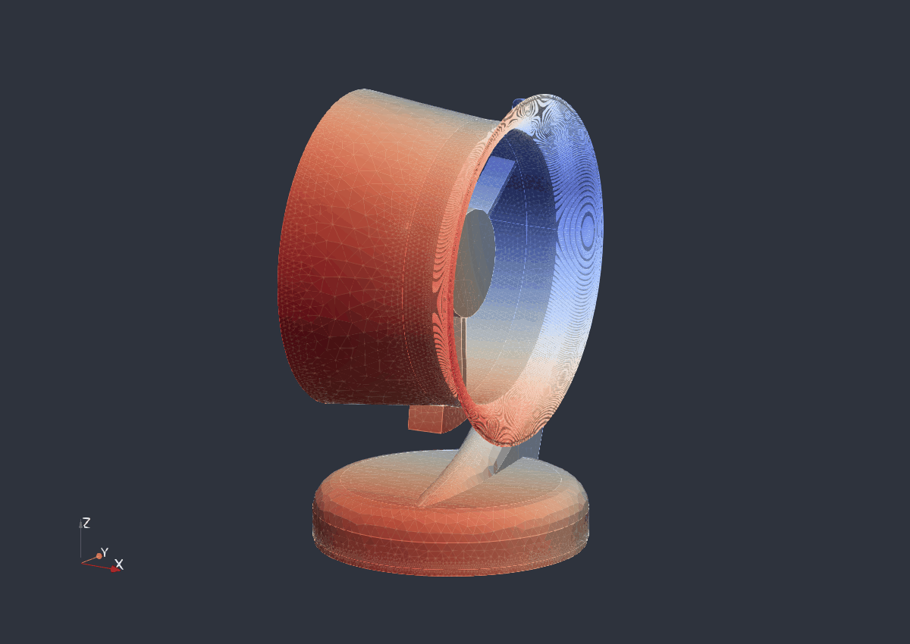
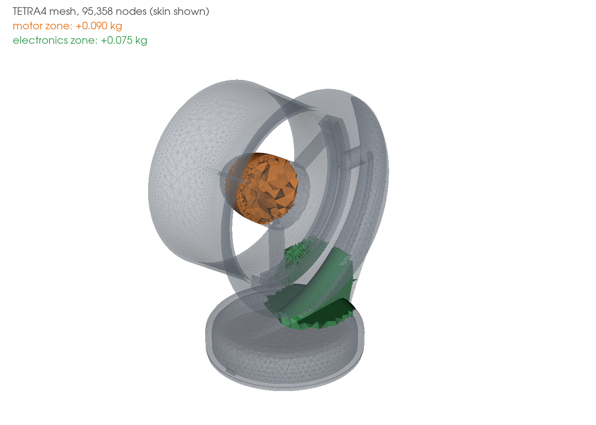

# Natural frequencies and impact response of a 3D-printed PETG-CF fan housing

Code_Aster study of a desk-fan housing printed in carbon-fibre PETG: converged free-free modes checked against the rotor harmonics at 2000 rpm (first mode 44 Hz at E = 6 GPa, 35 to 44 Hz over the plausible modulus range), and three impact cases followed to 30 ms with damping.

<p align="center">
  <br>
  <em>First elastic mode (shape from the June linear-element run; deformation amplified). The converged frequency is 44 Hz at E = 6 GPa.</em>
</p>

The fan is one of the first projects of Polytechnia, the engineering consultancy I co-founded in 2026. Its housing is printed in PETG-CF and carries a brushless motor in the duct and the electronics in the base. In June 2026 I wanted to know two things before printing it: does a natural frequency sit on an excitation line of the rotor, and where does the shroud concentrate stress if the fan is knocked over. In October 2026 I reran the study: a convergence check showed that the June frequencies were 12 to 20 % too high, the impact runs stopped too early, the oblique impact case held a slice of the housing fixed instead of a contact patch, and the modulus of printed PETG-CF had no source. Internal Polytechnia study, not a client deliverable. The airflow and noise of the same fan are simulated in [ducted-fan-aeroacoustics](https://github.com/clementdumeril/ducted-fan-aeroacoustics).

Skills: FE eigen-analysis checked against rotor harmonics, mesh and element-order convergence, linear transient FE with damping and singularity-aware post-processing, Python/h5py/VTK post-processing, Code_Aster and SALOME scripted end to end.

Full report, in preprint form: [`paper/main.pdf`](paper/main.pdf).

## Results

### Modes against the rotor lines

| Quantity | Value | Source |
|---|---:|---|
| Elastic modes 1 to 5, E = 6 GPa (quadratic elements, converged) | 44.0, 64.3, 109.9, 151.8, 192.1 Hz | [`data/convergence/`](data/convergence) |
| Same modes over E = 3.8 to 6.0 GPa | mode 1: 35.0 to 44.0 Hz | f ∝ √E |
| Rotor lines at 2000 rpm (nominal speed of this study) | 1X 33.3, 2X 66.7, 3X 100, 4X 133.3 Hz, BPF 166.7 Hz | |
| Crossings inside the modulus range | mode 3 with 3X at 4.97 GPa, mode 4 with 4X at 4.63 GPa, mode 5 with the BPF at 4.52 GPa | [`fig_campbell.py`](paper/scripts/fig_campbell.py) |

<p align="center">
  <br>
  <em>Each band spans a mode for E = 3.8 GPa (bottom) to 6.0 GPa (top). Open circles: the June linear-element values.</em>
</p>

The modulus used in June, 6 GPa, has no source; 3.8 GPa is the value published for FFF-printed PETG with 30 % carbon fibre (Prabhakaran et al., 2025). Within that range three modes cross a rotor line, so a resonance at 2000 rpm cannot be ruled out without measuring the printed part.

### Impact (0 to 30 ms)

| Impact case | Peak von Mises > 8 mm from contact, TETRA10, ζ = 5 % | Time | Location |
|---|---:|---:|---|
| Lateral, Y- side (shroud touches the floor) | 174 MPa | 27.4 ms | upper arm to shroud, impact side |
| Lateral, Y+ side (stand touches the floor) | 114 MPa | 3.0 ms | upper arm to motor hub |
| Oblique 45°, base edge touches the floor | 139 MPa | 8.2 ms | stand to shroud |

Source: [`shock/results_extended/`](shock/results_extended); all elements and damping levels are in the summary table of the [report](paper/main.pdf). Without damping the housing keeps vibrating and the maximum grows with the length of the window (166 to 218 MPa for the Y- case with quadratic elements), so only damped values are used. The two damped cases that had not settled at 30 ms were continued to 60 ms; their later maxima stay below the 0 to 30 ms peaks (163 MPa at 36.8 ms for Y-, 118 MPa at 43.8 ms for the oblique case). The peaks are local (95th percentile below 23 MPa) and sit at junctions of the arms and the stand with the shroud and the hub; linear elements give lower peaks and, for the Y- case, a different junction. They exceed the tensile strength reported for printed PETG-CF (about 60 MPa in the plane of the layers, 19 MPa across them for unfilled PETG). Either the impact as modelled would crack these junctions, or the idealisation (patch held fixed after the pulse, uniform 251 g pulse, linear elastic material) is too severe. Both readings point to a soft bumper on the shroud and the base edge, and larger fillets at these junctions.

<p align="center">
  <br>
  <em>Fixed nodes (black) and peak elements at 5 % damping, linear (open) and quadratic (filled) elements.</em>
</p>

<p align="center">
  <br>
  <em>Stress and displacement histories at 5 % damping: quadratic elements (solid) and linear elements (dashed).</em>
</p>

## What I built

- CAD preparation ([`cad/`](cad)): the original FreeCAD housing would not take a conforming tetrahedral mesh in NETGEN or Gmsh because of small faces and intersecting surfaces. I defeatured it (small faces and short edges removed, the detailed support arms replaced by simple ribs, one body taken out of a fusion), which cost 1.4 % of the volume, and oriented it with the base on the XY plane.
- Mesh ([`src/mesh/mesh_carter_netgen.py`](src/mesh/mesh_carter_netgen.py)): SALOME `FULL_NETGEN`, min 1 mm, max 10 mm, fineness 2, 95,358 nodes; for the convergence study, remeshes at fineness 1 to 4 (92k to 185k nodes), run from the command line.
- Material and masses: PETG-CF as an isotropic material (E = 6 GPa, ν = 0.35, ρ = 1300 kg/m³), carried over E = 3.8 to 6.0 GPa. The motor (estimated 0.090 kg) and the electronics (estimated 0.075 kg) are added as density in two spherical element groups, recomputed per mesh so the added masses stay exact.

  

- Modal solve: `CALC_MODES` in a frequency band, free-free, linear (TETRA4) and quadratic (TETRA10) elements, Code_Aster 16.9 and 17.4.
- Impact ([`shock/extended_2026-10/`](shock/extended_2026-10)): the nodes where the housing touches the floor held fixed (63, 63 and 107 nodes of the linear mesh for the three cases) and a 251 g, 2.5 ms acceleration pulse on the rest of the housing. The June runs used `DYNA_NON_LINE` on what is a linear problem; I switched to `DYNA_VIBRA` (same Newmark scheme, one factorisation), about 15 times cheaper, which made 30 ms runs with linear and quadratic elements and four damping levels affordable. Rayleigh damping is defined in the material and assembled with `AMOR_MECA`; an earlier version that combined the assembled matrices failed in the initial-acceleration step.
- Post-processing: Python scripts that read the `.rmed` results with h5py and report the raw maximum and the maximum, 99th and 95th percentile of the stress outside an 8 mm band around the contact ([`postprocess_extended.py`](shock/extended_2026-10/postprocess_extended.py)), and the figure and table scripts of the report ([`paper/scripts/`](paper/scripts)).

## How it works

The modal problem is K φ = ω² M φ on the free housing. With an isotropic material at fixed density, K scales with E and the mode shapes do not change, so every frequency scales with √E; that is how the modulus band is drawn. Each mode is compared with the rotor lines k × 2000/60 Hz and the blade-passing frequency 5 × 2000/60 Hz.

The impact model asks which regions of the housing load up when one patch is stopped and the rest decelerates at 251 g. It is linear, so it ranks regions and compares orders of magnitude; it does not predict cracking.

## How I checked it

<details>
<summary>Convergence, fixed patches, window length, solver equivalence, time step, and the June model checks</summary>

- Element order and mesh: linear tetrahedra keep lowering the frequencies as the mesh is refined (mode 1 from 49.2 to 46.5 Hz between 95k and 185k nodes); quadratic tetrahedra on three meshes give mode 1 between 43.88 and 43.97 Hz and agree within 0.5 % on modes 1 to 3.

  

- Fixed patches: plotting the fixed node groups showed that the June oblique case was wrong. Its plane was not tangent to the housing, so it fixed a slice of 1091 nodes cut through the shroud, the stand and the base. A fall in that direction first touches the edge of the base; the October oblique case puts the plane there, and the June oblique results are not used.
- Window length: the Y- and oblique cases with quadratic elements and 5 % damping, which had not settled at 30 ms, were continued to 60 ms. Both reproduce the 30 ms runs exactly up to 30 ms, and their later maxima are lower (163 MPa at 36.8 ms for Y-, 118 MPa at 43.8 ms for the oblique case).
- Transient solver: `DYNA_VIBRA` reproduces the June `DYNA_NON_LINE` results at every archived instant up to 2.5 ms (79.82 MPa, p95 7.070 MPa, 4.238 mm for the Y- case).
- Time step: halving it to 0.05 ms changes the Y- stress history by at most 0.4 % over 15 ms and leaves the peak unchanged.
- Steel first: the June chain was first run with steel; scaling its first mode by √(E/ρ) gives about 52 Hz for bare PETG-CF, consistent with the PETG-CF model once the components are added.
- Geometry and mass: mesh volume within 0.24 % of the prepared CAD; the mass-zone elements recounted from the MED file match Code_Aster.
- Solver output: Sturm count equal to the number of modes found; residual norms 2e-11 to 4e-8.
- Run checks: this Windows build of Code_Aster prints "DIAGNOSTIC JOB : OK" even after a fatal error, so the run queue also checks the message text and the result files.

</details>

## Limitations

- No measured material property: isotropic, linear elastic PETG-CF; a printed part is anisotropic and weaker between layers.
- Free-free modes: the stand and its support are not modelled. Motor and electronics are estimated masses without stiffness; the blades are not modelled.
- Impact: no contact law, friction or rebound (the patch stays fixed for 30 ms), uniform pulse, assumed Rayleigh damping; the Y- case reaches 30 to 40 mm of displacement, at the edge of the small-displacement assumption.
- No tap test, accelerometer measurement or drop test yet.

## Reproduce

Requires Code_Aster 17.4 (16.9 for the June reference run), SALOME 9.13 for meshing, Python 3 with numpy, matplotlib, h5py and vtk, and LaTeX for the report.

```bash
# mesh the prepared CAD with SALOME-NETGEN (terminal mode)
CARTER_BREP_PATH=cad/fan_housing_meshprep_v5_xy_z.brep salome -t src/mesh/mesh_carter_netgen.py

# modal solve (edit the paths in the .export first)
run_aster src/code_aster/carter_modal_petgcf_composants_v5_socle_xy_z.export

# impact runs: generate the inputs, run them, extract the time histories
# (CHOC_MESH = the MED mesh written by the meshing step; CHOC_RUN_ASTER = your Code_Aster launcher)
export CHOC_MESH=/path/to/carter_socle_xy_z_netgen.med CHOC_RUN_ASTER=run_aster
python shock/extended_2026-10/make_cases_vibra.py runs_30ms 0.03 0.0002            # TETRA4, undamped
CHOC_QUAD=1 CHOC_ZETA=0.05 python shock/extended_2026-10/make_cases_vibra.py runs_q5 0.03 0.0002
run_aster runs_q5/cyl_ymin.export
python shock/extended_2026-10/postprocess_extended.py runs_q5 runs_q5/time_history.csv

# figures, tables and report
bash paper/build_paper.sh
```

A TETRA4 modal run takes 3 to 5 min, a TETRA10 modal run about 25 min and 11 GB, a 30 ms impact run 15 to 65 min (TETRA4) or 50 to 80 min (TETRA10), a 60 ms TETRA10 run about 100 min, on 2 threads of a 4-core i7-6700HQ. Meshes and `.rmed` results (4 to 6.5 GB per impact run) are not versioned; the CSV time histories and solver logs are.

## Credits

- Fan CAD: Polytechnia FreeCAD model. CAD preparation, meshing, Code_Aster models, post-processing and report: Clément Dumeril.
- Tools: Code_Aster (EDF), SALOME-NETGEN, ParaView, FreeCAD.

[clement.dumeril.net](https://clement.dumeril.net) · [github.com/clementdumeril](https://github.com/clementdumeril) · MIT licence
