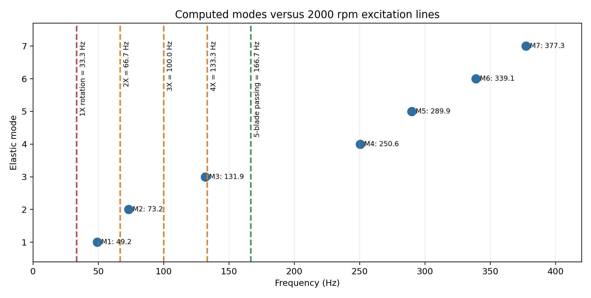
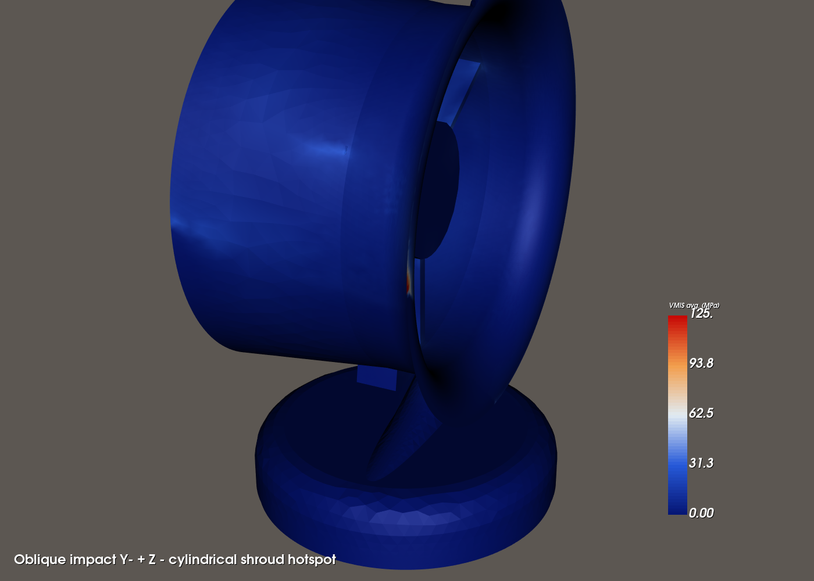
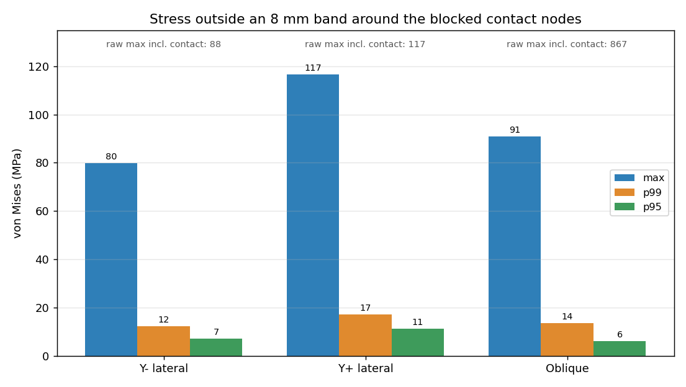
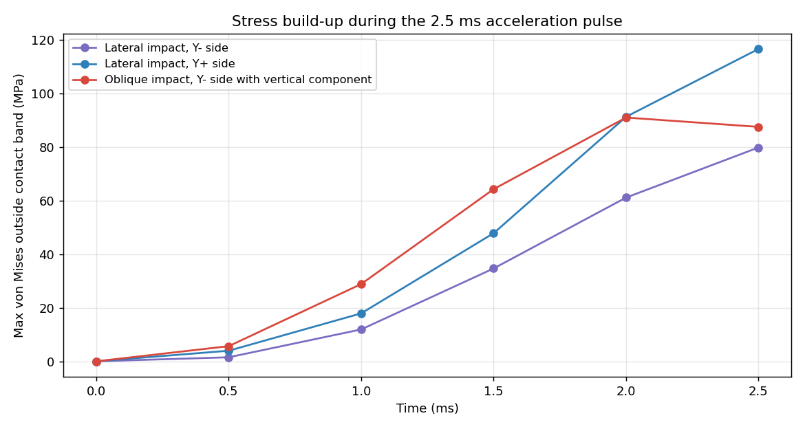

# Modal and drop-shock analysis of a 3D-printed PETG-CF fan housing

Code_Aster finite-element study of a desk-fan housing printed in carbon-fibre PETG: first elastic mode at 49.2 Hz (free-free), mode 3 within 1 % of the 4X rotation harmonic at 2000 rpm, and local stress peaks of 80 to 117 MPa in a simplified 2.5 ms impact on the cylindrical shroud.

<p align="center">
  <br>
  <em>First elastic mode, 49.2 Hz. Deformation amplified for readability; colour is displacement magnitude.</em>
</p>

The fan is one of the first projects of Polytechnia, the engineering consultancy I co-founded in 2026. Its housing is printed in PETG-CF and carries a brushless motor in the duct and the electronics in the base. In June 2026 I wanted to know two things before printing it: does any natural frequency sit on an excitation line of the rotor, and where does the shroud concentrate stress if the fan is knocked over. This is an internal study; it has not been delivered to a client. The airflow and noise of the same fan are simulated in [ducted-fan-aeroacoustics](https://github.com/clementdumeril/ducted-fan-aeroacoustics).

## Results

### Modal (free-free, 1 to 1500 Hz)

| Quantity | Value | Source |
|---|---:|---|
| Mesh | 95,358 nodes, 312,777 TETRA4 | [solver log](src/code_aster/solver_log_code_aster.txt) |
| Total mass (PETG-CF + motor + electronics) | 1.080 kg | [`equivalent_mass_distribution.csv`](data/equivalent_mass_distribution.csv) |
| Elastic modes 1 to 3 | **49.2**, 73.2, 131.9 Hz | [`modal_frequencies.csv`](data/modal_frequencies.csv) |
| Excitation lines at 2000 rpm | 1X 33.3 Hz, 4X 133.3 Hz, 5-blade BPF 166.7 Hz | |
| Closest coincidence | mode 3 vs 4X: 1.4 Hz apart (1.0 %) | |

<p align="center">
  <br>
  <em>Computed modes against the rotation harmonics at 2000 rpm. Mode 1 sits above 1X; mode 3 is the one to watch.</em>
</p>

### Drop shock (transient, three impact cases on the shroud)

| Impact case | Max von Mises, outside an 8 mm contact band | p95 | Max displacement |
|---|---:|---:|---:|
| Lateral, Y- side | 80 MPa | 7 MPa | 4.2 mm |
| Lateral, Y+ side | 117 MPa | 11 MPa | 3.7 mm |
| Oblique, Y- side with vertical component | 91 MPa | 6 MPa | 1.9 mm |

Source: [`synthese_robuste_choc_cylindrique_v1.csv`](shock/results/synthese_robuste_choc_cylindrique_v1.csv). The peaks are very local (p95 an order of magnitude lower) and sit on the lips and arm-to-shroud junctions, between z = 145 and 200 mm. The raw maximum of the oblique case, 867 MPa, is on the blocked contact nodes and is a boundary-condition singularity, not a housing stress.

<p align="center">
  
  <br>
  <em>Left: von Mises hot spot on the shroud, oblique impact. Right: max, p99 and p95 outside the contact band for the three cases.</em>
</p>

## What I built

- CAD preparation ([`cad/`](cad)): the original FreeCAD housing would not take a conforming tetrahedral mesh in NETGEN or Gmsh because of small faces and intersecting surfaces. I defeatured it (small faces and short edges removed, one body taken out of a fusion), which cost 1.4 % of the volume, and exported a clean STEP/BREP. A voxel mesh (h = 3 mm) was my fallback in the meantime; it lost 12.5 % of the volume, so I dropped it once the conforming mesh worked.
- Mesh ([`src/mesh/mesh_carter_netgen.py`](src/mesh/mesh_carter_netgen.py)): SALOME-NETGEN tetrahedra, 95,358 nodes and 312,777 TETRA4.
- Material and masses ([`.comm`](src/code_aster/carter_modal_petgcf_composants_v5_socle_xy_z.comm)): PETG-CF as an equivalent isotropic material (E = 6000 MPa, ν = 0.35, ρ = 1300 kg/m³). The motor (5010 360KV brushless, estimated 0.090 kg) and the electronics (ESP32-S3 board, motor controller, switch, estimated 0.075 kg together) are not modelled as solids; their mass is spread over two spherical element groups by raising the density there, without adding stiffness.

  

- Modal solve: `CALC_MODES` with the band option between 1 and 1500 Hz, free-free, Code_Aster 16.9.
- Several model versions: a steel sanity model, PETG-CF with the component masses (V2), then re-orientations (V3 to V5) until the base rests on the XY plane and the fan height follows +Z, which makes the drop cases easy to set up.
- Drop shock ([`shock/code_aster/`](shock/code_aster)): `DYNA_NON_LINE` with Newmark time integration on the same mesh and masses. The contact patch is a group of blocked nodes (63 nodes for the lateral cases, 1091 for the oblique one), and the rest of the housing receives a triangular acceleration pulse of 251 g peak over 2.5 ms. The three cases are generated by [a script](shock/code_aster/generate_cylindrical_drop_cases.py) and ran on a 2-node Linux cluster I set up (Code_Aster 17.4 in Apptainer).
- Post-processing: Python scripts that extract maxima from the `.rmed` results, compute robust metrics excluding 4, 8 and 12 mm bands around the contact, and draw the figures ([`shock/scripts/`](shock/scripts), [`src/postprocessing/`](src/postprocessing)). Reports in LaTeX: [modal, English](reports/modal_report_petgcf_v5_en.pdf); shock, French ([`docs/shock_report_fr.pdf`](docs/shock_report_fr.pdf)).

## How it works

The modal problem is the generalised eigenproblem K φ = ω² M φ on the free housing. Without supports, the first six modes are rigid-body motions near 0 Hz; starting the search band at 1 Hz leaves only the elastic modes. Each one is then compared with the excitation lines of the rotor, n × 2000/60 Hz for the rotation harmonics and 5 × 2000/60 Hz for the blade-passing frequency.

The shock model does not simulate contact. It asks a simpler question: if the housing is stopped at one patch while the rest decelerates at 251 g, which regions concentrate stress? Ranking the three impact directions and locating the hot spots is what the model can answer; a failure verdict is not.

## How I checked it

- Steel first. The first runs used steel (E = 210 GPa) to validate the chain. Scaling that steel first mode (125.7 Hz) by √(E/ρ) gives about 52 Hz for bare PETG-CF; with the 0.165 kg of components the PETG-CF model gives 49.2 Hz, which is consistent.
- Geometry: mesh volume 704,189 mm³ against 705,872 mm³ for the prepared CAD (0.24 %).
- Mass model: I recount the elements of each mass zone directly from the MED file ([`render_mesh_mass_zones.py`](src/postprocessing/render_mesh_mass_zones.py)) and get the same 23,127 and 11,616 elements as Code_Aster. The total mass, 1.080446 kg, is integrated element by element.
- Solver: the Sturm count gives 21 eigenvalues in the band and 21 modes were found; residual norms are between 2e-11 and 4e-8, and the run ends with no alarm.
- Re-orienting the model between V2 and V5 (pure rotations of the mesh and mass centres) leaves mode 1 at 49.214 Hz, as it should.
- Shock singularity: the contact nodes carry the raw maximum (867 MPa in the oblique case). I excluded bands of 4, 8 and 12 mm around them and report the 8 mm values plus p95/p99, so the numbers describe the housing and not the boundary condition.

<p align="center">
  <br>
  <em>Stress outside the contact band during the pulse. The Y+ case still rises at the last computed step (see limitations).</em>
</p>

## Limitations

- No mesh convergence study: a single NETGEN mesh with linear tetrahedra, which are stiff, so the frequencies are probably somewhat overestimated.
- PETG-CF is isotropic here. A printed part is anisotropic, with weaker layer adhesion, and none of its properties were measured.
- Free-free boundary conditions: the real fan stands on a base, so supported modes will differ. Damping is not estimated.
- The blades are not in the model. A mass-only estimate (f × √(M₀/(M₀+ΔM))) lowers mode 3 to 124 to 130 Hz for 25 to 150 g of blades ([figure](assets/figures/blade_mass_sensitivity_en.png)), which moves it away from 4X, but it ignores where that mass sits.
- The shock pulse is not exactly a 0.8 m drop: its velocity change is 3.11 m/s against 3.96 m/s for a free fall from 0.8 m. There is no contact law, friction or rebound, and the run stops at 2.5 ms, at the end of the pulse, while the Y+ stress is still rising.
- No failure assessment: the strength and inter-layer toughness of printed PETG-CF are unknown, so the stresses rank regions; they do not predict cracking.
- No experimental check (tap test or accelerometer) yet.

## Reproduce

Requires Code_Aster (16.9 or later), SALOME for meshing, Python 3 with numpy, matplotlib, h5py and vtk.

```bash
# mesh the prepared CAD (cad/fan_housing_meshprep_v5_xy_z.brep) with SALOME-NETGEN
CARTER_BREP_PATH=cad/fan_housing_meshprep_v5_xy_z.brep salome shell -- python src/mesh/mesh_carter_netgen.py

# modal solve (edit the paths in the .export first)
run_aster src/code_aster/carter_modal_petgcf_composants_v5_socle_xy_z.export

# shock cases: one .export per case in shock/code_aster/ (same path edit)
run_aster shock/code_aster/carter_choc_cyl_ymin.export

# English figures from the CSV results and the mesh
python shock/scripts/make_shock_figures_en.py
python src/postprocessing/render_mesh_mass_zones.py <mesh.med>
```

The `.med` mesh (28 MB) and the `.rmed` results (over 1 GB for the shock cases) are not versioned. The CSV files in [`data/`](data) and [`shock/results/`](shock/results) and the solver logs hold the published numbers.

## Credits

- Fan CAD: Polytechnia FreeCAD model. CAD preparation, meshing, Code_Aster models, post-processing and reports: Clément Dumeril.
- Tools: Code_Aster (EDF), SALOME-NETGEN, ParaView, FreeCAD.

[clement.dumeril.net](https://clement.dumeril.net) · [github.com/clementdumeril](https://github.com/clementdumeril)
