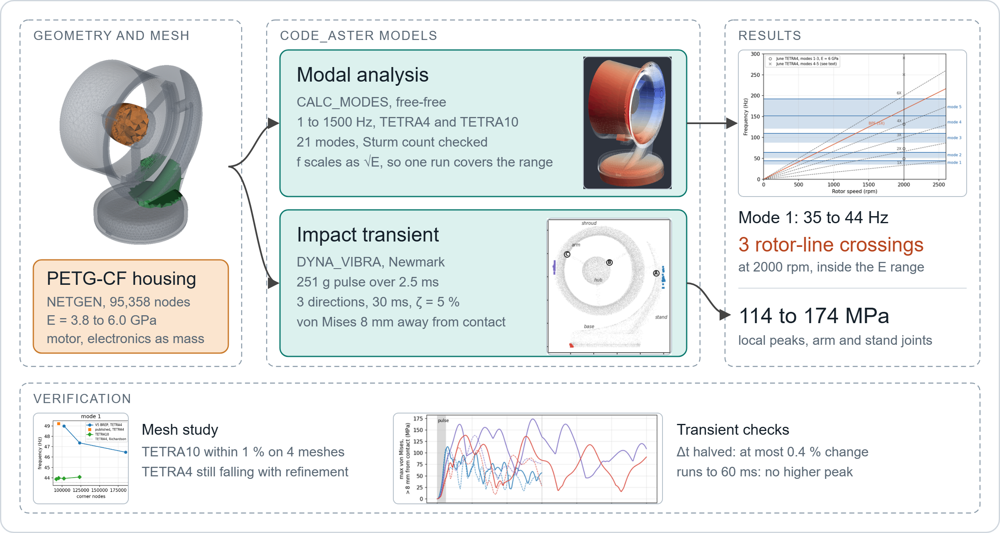
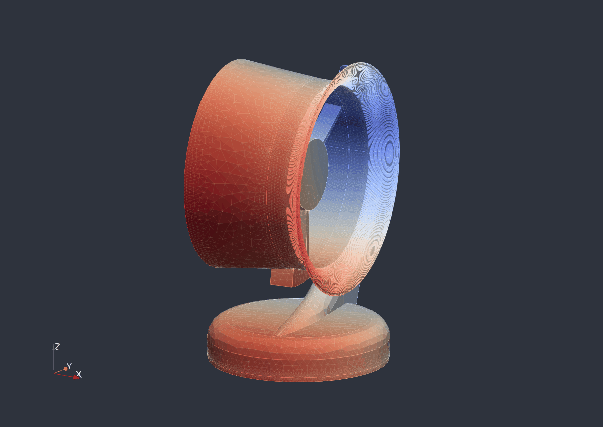

# PETG-CF fan housing: modal and impact analysis

[Report (PDF)](paper/main.pdf) · [Details](docs/details.md) · [Model assumptions](docs/model_assumptions.md) · [Reproducibility](docs/reproducibility.md) · [Airflow and noise of the same fan](https://github.com/clementdumeril/ducted-fan-aeroacoustics) · [Cite](CITATION.cff)



Code_Aster models of a 3D-printed desk-fan housing. With quadratic tetrahedra, the first free-free mode lies at 35 to 44 Hz over the plausible modulus range (E = 3.8 to 6.0 GPa), and modes 3 to 5 cross rotor lines at 2000 rpm inside that range, so a resonance cannot be ruled out without measuring the part. Three damped impact cases (251 g, 2.5 ms pulse) give local von Mises peaks of 114 to 174 MPa at the arm and stand junctions.

## Method

The FreeCAD model was defeatured and meshed with NETGEN (95,358 nodes, 312,777 tetrahedra), run with linear (TETRA4) and quadratic (TETRA10) elements. PETG-CF is isotropic linear elastic; motor and electronics are estimated masses added as extra density. The modal problem is free-free, solved with `CALC_MODES` in 1 to 1500 Hz; since K is proportional to E, f scales exactly as √E. The impact model fixes a small contact patch and applies a triangular acceleration pulse (about a 0.5 m fall, no rebound), solved with `DYNA_VIBRA` (Newmark, Δt = 0.1 ms, 30 ms, Rayleigh damping ζ = 5 %). Stress is read more than 8 mm from the contact patch. Full formulation and checks: [docs/details.md](docs/details.md).

This was an internal study at Polytechnia, the engineering consultancy I co-founded in 2026. Mine: CAD preparation, meshes, Code_Aster models, verification runs, post-processing and report. Reused: the fan CAD (Polytechnia FreeCAD model), Code_Aster (EDF), SALOME-NETGEN, ParaView.

## Results

| Quantity (TETRA10) | Value | Source |
|---|---|---|
| Mode 1, E = 3.8 to 6.0 GPa | 35.0 to 44.0 Hz | `data/convergence/pub_quad/tables.txt` |
| Rotor-line crossings at 2000 rpm | mode 3 / 3X at 4.97 GPa, mode 4 / 4X at 4.63 GPa, mode 5 / BPF at 4.52 GPa | `paper/scripts/fig_campbell.py` |
| Impact, lateral −y | 174 MPa at 27.4 ms, upper arm to shroud | `shock/results_extended/time_history_quad_zeta05.csv` |
| Impact, lateral +y | 114 MPa at 3.0 ms, upper arm to motor hub | same |
| Impact, oblique on the base edge | 139 MPa at 8.2 ms, stand to shroud | `shock/results_extended/time_history_quad_base_edge_zeta05.csv` |
| 95th percentile of von Mises, all cases | below 23 MPa | same |

TETRA10 frequencies agree within 1 % on four meshes; the impact peaks are not mesh-converged (+3 to +26 % from TETRA4 to TETRA10). The peaks are local, at junctions where the arms were simplified to plain ribs.

<p align="center">
  <br>
  <em>First elastic mode (June linear-element run, deformation amplified).</em>
</p>

## Install and quick start

The paper scripts need only NumPy and Matplotlib and read the committed tables and CSV files (tested on Windows 10, Python 3.11.9). Meshing used SALOME 9.13; solver runs used Code_Aster 16.9 and 17.4.

```bash
pip install -r requirements.txt
python paper/scripts/fig_campbell.py      # mode bands and crossing moduli
python paper/scripts/fig_convergence.py   # convergence table and Richardson estimate
python paper/scripts/fig_shock.py         # impact peaks, times, p95
bash paper/build_paper.sh                 # all figures and tables, then the report
```

Meshing and solver commands: [docs/details.md](docs/details.md#all-run-commands) and [docs/reproducibility.md](docs/reproducibility.md).

## Code structure

| Path | Content |
|---|---|
| `cad/` | defeatured housing (STEP, BREP) |
| `src/` | meshing script, June reference modal input, post-processing |
| `data/convergence/` | October modal runs: input, mesh statistics, frequency table per mesh |
| `shock/` | June and October impact inputs, solver messages, time histories |
| `paper/` | report source, figure and table scripts, PDF |
| `docs/` | details, assumptions, reproducibility, June reports in `docs/archive/` |

## Limitations

- No material property was measured; a printed part is anisotropic and the component masses are estimates.
- Free-free modes, with no mounting stiffness.
- The impact patch stays clamped after the pulse and there is no contact law or rebound, so the late −y peak may be an artifact.
- The impact peaks are local and not mesh-converged.
- No tap test, accelerometer measurement or drop test yet. The June 2026 numbers were corrected in October ([details](docs/details.md#corrections)).

## Citation and license

Cite with [`CITATION.cff`](CITATION.cff) or the report. MIT license, see [LICENSE](LICENSE). The 3.8 GPa modulus is from Prabhakaran et al. 2025, cited in [`paper/references.bib`](paper/references.bib).

Clément Dumeril · [clement.dumeril.net](https://clement.dumeril.net)
